# Streamable HTTP の MCP クライアントは 2026-07-28 か legacy か、どこを診断するか

> 想定読者：MCP サーバーとその手前の中継を、HTTP の記録から診断する人。legacy の initialize とセッションは知っている前提。
> 使う場面：顧客から連携された MCP サーバーの疎通確認で、legacy か新仕様かを意識するとき。
> 省いたもの：MCP・JSON-RPC・SSE・OAuth の基礎、stdio、HTTP+SSE の細部、Tasks と MCP Apps、一覧のキャッシュ。MCP サーバーの認証認可も扱わない。アクセストークンをすべての HTTP リクエストの `Authorization` ヘッダーに載せる要件は、どちらのプロトコルバージョンでも同じなので、別の資料にする。ただし、どちらでも意識しておく `Origin` と `iss` の検証は、5 節の終わりに残した。
> 所要時間：10 分。
> 検証方法：振り分けの例は `examples/classify.mjs` を実行した出力を貼った。仕様の要件は、`sources/` に保存した原文から 1 文ずつ取り出して貼り、`checks.json` で照合した。

この資料は、クライアントが 2026-07-28 以降と 2025-11-25 以前のどちらのプロトコルバージョンで話しているかは 1 本目の POST で決まり、診断で見る場所もそれで変わることを伝える。
modern ではヘッダーと本文の食い違い、legacy ではセッションとサーバー発のリクエストを見る。
Dual-era のサーバーでは両方の経路が開いている。

modern・legacy・Dual-era は仕様の呼び名で、2026-07-28 の [Terminology](https://modelcontextprotocol.io/specification/2026-07-28/basic/versioning#terminology) が定義している。

<!-- output: spec-terms -->
```
**Modern**: protocol versions that convey version, identity, and capabilities as per-request metadata (revision `2026-07-28` and later).
**Legacy**: protocol versions that establish a session with an `initialize` handshake (`2025-11-25` and earlier).
**Dual-era**: an implementation that supports both modern and legacy versions.
```

<details><summary>節ごとの役割</summary>

| 節 | 役割 | 見せるもの | なぜ |
|---|---|---|---|
| 0 | 見分け方と診断対象を 1 枚に | 表 2 つ | 本文を読まずに持ち帰れるように |
| 1 | 1 本の記録からプロトコルバージョンを判定する | `classify.mjs` の出力 | 途中から見た記録でも判定できるように |
| 2 | Dual-era クライアントが legacy へ落ちる条件 | 分岐の図 | 中継の 400 で経路が変わることを診断に入れるため |
| 3 | 組み合わせごとに、どの観点が対象になるか | 組み合わせの表 | 対象外の項目を外すため |
| 4 | modern 経路の診断観点 | 食い違いの例 | modern で増えた攻撃面を押さえるため |
| 5 | legacy 経路の診断観点 | 原文の要件 | Dual-era で残る攻撃面を押さえるため |

</details>

## 0. 一枚で

見分け方は次の表のとおり。
判定に使うのは、仕様に従う実装なら必ずそうなる MUST・REQUIRED の行。
MAY の行は実装しだいなので、見当たらなくても legacy を否定しない。

| 観察するもの | modern：2026-07-28 以降 | legacy：2025-11-25 以前 | 要件 |
|---|---|---|---|
| [1 本目の POST](https://modelcontextprotocol.io/specification/2025-11-25/basic/lifecycle#initialization) | `initialize` が無く、いきなり `tools/list` などを送る | `initialize` → `notifications/initialized` | legacy は MUST |
| [本文の `params._meta`](https://modelcontextprotocol.io/specification/2026-07-28/basic/patterns/mrtr) | `io.modelcontextprotocol/protocolVersion` と `clientCapabilities` が毎回ある | 無い | modern は MUST |
| [`MCP-Protocol-Version`](https://modelcontextprotocol.io/specification/2026-07-28/basic/transports/streamable-http#protocol-version-header) | `2026-07-28`。`_meta` と同じ値 | initialize の後に `2025-06-18` や `2025-11-25`。2025-03-26 のクライアントは付けない | どちらも MUST。legacy は 2025-06-18 以降 |
| [`Mcp-Method` と `Mcp-Name`](https://modelcontextprotocol.io/specification/2026-07-28/basic/transports/streamable-http#standard-request-headers) | `Mcp-Method` は全リクエスト、`Mcp-Name` は `tools/call`・`resources/read`・`prompts/get` | 無い | modern は REQUIRED |
| [結果の `resultType`](https://modelcontextprotocol.io/specification/2026-07-28/basic#result-responses) | `complete` か `input_required` | 無い | modern は MUST |
| サーバーからの入力要求 | 結果の `inputRequests` に入り、クライアントが再送する | SSE 上で `sampling/createMessage` などが届く | modern は MUST、legacy は MAY |
| [`MCP-Session-Id`](https://modelcontextprotocol.io/specification/2025-11-25/basic/transports#session-management) | 付けない | サーバーが返したときだけ、以後すべてに付ける | 発行は MAY、付けるのは MUST |
| HTTP メソッド | POST だけ | POST に加えて、GET の待ち受けと DELETE の終了がありうる | GET は MAY、DELETE は SHOULD |

診断で見る場所は、どちらのプロトコルバージョンかで次のように分かれる。

| 経路 | 主な観点と要件の強さ | 対象になる条件 |
|---|---|---|
| modern | ヘッダーと本文の食い違いを拒否するか（MUST）、`Mcp-Name` の Base64 をデコードしてから比べるか（MUST）、中継が古い版のヘッダーを信頼しないか（SHOULD）、`requestState` の改ざんを拒否するか（認可や処理に効くなら MUST）、旧来の GET・DELETE に 405 を返すか（SHOULD） | サーバーが modern を話す |
| legacy | Session ID が推測できないか（SHOULD）、終了後に 404 になるか（MUST）、`Last-Event-ID` で別のストリームを再送しないか（MUST NOT）、SSE 上の sampling を利用者が拒否できるか（SHOULD） | サーバーが initialize に応える |
| 切り替え | Dual-era クライアントが 400 の本文を見てから legacy へ移るか（SHOULD）。両経路の認可が同じかは規範外の観点 | クライアントかサーバーが Dual-era |
| 共通 | 不正な `Origin` に 403 を返すか（MUST）、認可レスポンスの `iss` を検証するか（2026-07-28 からクライアントの MUST） | どちらでも |

## 1. 1 本の記録からプロトコルバージョンを判定する

1 本目の POST が見えていれば、それで決まる。
legacy のクライアントは initialize から始めなければならず、modern には initialize が無い。

<!-- output: spec-init -->
```
The initialization phase **MUST** be the first interaction between client and server.
```

途中から見た記録では、`_meta` → `MCP-Session-Id` → `MCP-Protocol-Version` の順に手がかりを探す。

`examples/captures.json` には、仕様の例をもとにした記録を 9 本入れた。
ここでは途中から見た記録の A〜F の 6 本を示す。G と H は 2 節、I は 4 節で示す。

<!-- output: classify -->
```
A modern の tools/call: modern — _meta に io.modelcontextprotocol/protocolVersion
B legacy の initialize: legacy — initialize で始まる
C legacy の途中（セッションあり）: legacy — MCP-Session-Id を付けている
  応答: resultType が無い結果 → 旧版サーバーの complete として扱う
D legacy の途中（セッションなし）: legacy — MCP-Protocol-Version: 2025-06-18
E 2025-03-26 の途中: legacy — MCP-Protocol-Version が無い（2025-03-26 として扱われる）
F GET の待ち受け: legacy — GET の SSE 待ち受けは 2025-11-25 まで
```

D と E が、途中から見たときに迷う記録になる。
legacy でもセッションを返さないサーバーはあり、そのときは `MCP-Protocol-Version` の値だけが手がかりになる。

E のようにヘッダーが無い POST は、クライアント側の要件から判定する。
2026-07-28 のクライアントはすべての POST に付ける。2025-06-18 以降の legacy クライアントも、initialize の後は付ける。

<!-- output: spec-version-header -->
```
Every POST request to the MCP endpoint **MUST** include an `MCP-Protocol-Version` header.
```

<!-- output: spec-legacy-header -->
```
If using HTTP, the client **MUST** include the `MCP-Protocol-Version: <protocol-version>` HTTP header on all subsequent requests to the MCP server, allowing the MCP server to respond based on the MCP protocol version.
```

仕様に従うクライアントでヘッダーを付けないのは、ヘッダーが定義される前の 2025-03-26 だけになる。
ただし、中継がヘッダーを落としたときも同じ記録になる。同じクライアントの initialize が記録にあれば、その `protocolVersion` で確かめる。

ヘッダーの無いリクエストを 2025-03-26 として受け入れてよい、という要件もあるが、これはサーバー側の MAY で、記録の判定の根拠にはならない。
診断では、そのサーバーが最も古い版の扱いを受け入れているか、という観点として使う。

<!-- output: spec-version-header -->
```
A server that supports clients implementing protocol versions earlier than `2025-06-18` (which did not define the `MCP-Protocol-Version` header) **MAY** treat a request that omits the header as protocol version `2025-03-26`.
```

自分の記録を振り分けるときは、同じ形の JSON にして `node examples/classify.mjs <file>` を実行する。

## 2. Dual-era クライアントは、本文の無い 400 で legacy へ落ちる

Dual-era のクライアントは、まず modern の POST を送る。
4xx が返ったときは本文を読み、modern のエラーでなければ initialize へ切り替える（[Backward Compatibility](https://modelcontextprotocol.io/specification/2026-07-28/basic/transports/streamable-http#backward-compatibility)）。



<!-- output: spec-fallback -->
```
On `400 Bad Request`, the client **SHOULD** inspect the response body before falling back: modern servers also use `400` for [`UnsupportedProtocolVersionError`][unsupported-version], `MissingRequiredClientCapabilityError`, and header-validation failures.
If the body contains a recognized modern JSON-RPC error, the server speaks a modern version of MCP — retry using the advertised `supported` versions or correct the request, rather than falling back.
If the body is empty or is not a recognized modern JSON-RPC error, fall back to `initialize` and continue with the legacy version for subsequent requests.
```

modern のエラーの主なものは、`-32020` HeaderMismatch、`-32021` MissingRequiredClientCapability、`-32022` UnsupportedProtocolVersion と、404 に付く `-32601` の 4 つ。
G は modern のエラーが返った記録で、クライアントは legacy へ移らない。
H のように WAF やゲートウェイが自前の 400 ページを返すと、本文に modern のエラーが無いので、クライアントは legacy へ切り替える。

<!-- output: classify -->
```
G 版が合わない modern: modern — _meta に io.modelcontextprotocol/protocolVersion
  応答: modern サーバー（-32022 UnsupportedProtocolVersion）→ フォールバックしない
H 中継が本文を差し替えた 400: modern — _meta に io.modelcontextprotocol/protocolVersion
  応答: 400 に modern のエラーが無い → initialize へフォールバック
```

クライアントはこの判定を、HTTP ではオリジン単位で保存する（SHOULD）。

<!-- output: spec-cache -->
```
Clients **SHOULD** cache the result for the lifetime of the server process (stdio) or origin (HTTP), and **MAY** persist it across restarts of the same server configuration, re-probing if the cached assumption later fails.
```

判定を保存するクライアントなら、中継が 1 回本文を差し替えただけで、以後の通信が legacy の経路に移りうる。
どこまで続くかは実装しだいになる。保存は SHOULD、再起動をまたぐ保存は MAY で、保存した前提が崩れればクライアントは調べ直す。
ここは仕様の要件を組み合わせた推論で、実際のクライアントで確かめてはいない（未検証）。案件では、主張ではなく試験の項目として扱う。

## 3. 組み合わせごとに、どの観点が対象になるか

仕様の[組み合わせの表](https://modelcontextprotocol.io/specification/2026-07-28/basic/versioning#compatibility-matrix)から、HTTP の行だけを抜いた。

| クライアント | サーバー | 結果 | 対象になる観点 |
|---|---|---|---|
| modern | modern 専用 | 動く | modern だけ。旧来の GET・DELETE が 405 になるかも見る |
| modern | Dual-era | 動く | modern。加えて、legacy の経路が同じ認可で守られているか |
| modern | legacy | 失敗する。応答を返さない、エラーを返す、legacy の意味で処理する、のどれもありうる | 2xx が返るなら、ヘッダーを検証しない後段がある |
| Dual-era | legacy | initialize へ切り替えて動く | legacy。切り替えの条件は 2 節 |
| legacy | modern 専用 | 必須ヘッダーが無く 400。上の版へ移る仕組みは無い | legacy の観点は対象外 |
| legacy | Dual-era | 動く。サーバーはセッション単位で legacy の動きをする | legacy |

modern 専用サーバーに legacy の観点を当てても、何も出ない。
逆に Dual-era サーバーでは、modern 側を直しても legacy 側から同じ操作ができるかを見る。

## 4. modern 経路の診断観点

中心は、ヘッダーと本文の食い違いになる。
中継が `Mcp-Name` で認可し、サーバーが本文の `name` で実行すると、許されていないツールを呼べる。
サーバーは食い違いを 400 と `-32020` で拒否しなければならない（[Server Validation](https://modelcontextprotocol.io/specification/2026-07-28/basic/transports/streamable-http#server-validation)）。

<!-- output: spec-validation -->
```
Servers that process the request body **MUST** reject requests where the values specified in the headers do not match the corresponding values in the request body.
```

<!-- output: classify -->
```
I ヘッダーと本文が食い違う modern: modern — _meta に io.modelcontextprotocol/protocolVersion
  不一致: mcp-name: ヘッダー "read_only" ≠ 本文 "delete_all"
  応答: modern サーバー（-32020 HeaderMismatch）→ フォールバックしない
```

この例では、`Mcp-Name` を Base64 の形式 `=?base64?…?=` で送った。
サーバーはデコードしてから本文と比べる（MUST、[Value Encoding](https://modelcontextprotocol.io/specification/2026-07-28/basic/transports/streamable-http#value-encoding)）。
デコードせずに比べる実装や、中継だけがデコードする構成は、ここで食い違う。

<!-- output: spec-validation -->
```
In particular, servers **MUST** decode an encoded `Mcp-Name` or `Mcp-Param-{Name}` value before comparing it to the corresponding request body value during [Server Validation](#server-validation).
```

ヘッダーで制御する中継は、`MCP-Protocol-Version` が古いか無いリクエストを拒否する（SHOULD）。
古い版のリクエストでは、後段がヘッダーと本文を照合しないため。

<!-- output: spec-intermediary -->
```
Intermediaries that enforce policy based on mirrored headers (e.g., routing or rate-limiting by tenant) **SHOULD** verify that the `MCP-Protocol-Version` header indicates a version that requires header–body validation.
If the version is older or the header is absent, the intermediary **SHOULD** reject the request rather than trusting unvalidated header values.
```

ほかの観点は次の 3 つ。

| 観点 | 原文の要件 |
|---|---|
| `requestState` を書き換えて再送する。別の利用者の state、期限切れの state、別のリクエストの state を送る | 攻撃者が操作できる入力として扱う（MUST）。認可や処理に効くなら HMAC・AEAD で守り、検証に失敗した state を拒否する（MUST）。主体・有効期限・元のリクエストの照合は SHOULD。1 回限りの処理はサーバー側で保証する（MUST）。[MRTR](https://modelcontextprotocol.io/specification/2026-07-28/basic/patterns/mrtr#server-requirements-basic-workflow) |
| 旧来の GET・DELETE、`MCP-Session-Id`、`Last-Event-ID` を送る | GET・DELETE は 405、2 つのヘッダーは無視する（SHOULD、modern 専用サーバー）。[Earlier Streamable HTTP Revisions](https://modelcontextprotocol.io/specification/2026-07-28/basic/transports/streamable-http#earlier-streamable-http-revisions) |
| modern の POST に、`resultType` の無い 2xx が返るか | modern の結果は `resultType` を含む（MUST）。無い結果を、クライアントは旧版サーバーの `complete` として扱う（MUST）。modern の POST に `resultType` の無い 2xx が返るなら、後段が legacy の意味で処理している。[Result Responses](https://modelcontextprotocol.io/specification/2026-07-28/basic#result-responses) |

<!-- output: spec-mrtr -->
```
If a client request contains a `requestState` field, servers **MUST** treat `requestState` as an attacker-controlled input.
If `requestState` influences authorization, resource access, or business logic, servers **MUST** protect its integrity (e.g. HMAC or AEAD) and **MUST** reject state that fails verification.
Servers for which a given `requestState` must be consumed at most once (e.g., one-time redemptions) **MUST** enforce that invariant server-side.
```

<!-- output: spec-resulttype -->
```
The `result` **MUST** include a `resultType` field to indicate the type of the result.
For backward compatibility with servers implementing earlier protocol versions, which do not include `resultType`, clients **MUST** treat an absent `resultType` as `"complete"`.
```

## 5. legacy 経路の診断観点

Dual-era サーバーが initialize に応える限り、2025-11-25 までの攻撃面が残る。
要件は 2025-11-25 の[Session Management](https://modelcontextprotocol.io/specification/2025-11-25/basic/transports#session-management)と[Resumability](https://modelcontextprotocol.io/specification/2025-11-25/basic/transports#resumability-and-redelivery)にある。

<!-- output: spec-session -->
```
The session ID **SHOULD** be globally unique and cryptographically secure (e.g., a securely generated UUID, a JWT, or a cryptographic hash).
The server **MAY** terminate the session at any time, after which it **MUST** respond to requests containing that session ID with HTTP 404 Not Found.
The server **MUST NOT** replay messages that would have been delivered on a different stream.
```

| 観点 | 対象になる条件 |
|---|---|
| Session ID が推測できないか。終了後に 404 になるか（MUST）。DELETE で終了できるか | initialize の応答に `MCP-Session-Id` が付く |
| `Last-Event-ID` で、別のストリームのメッセージが再送されないか（MUST NOT） | サーバーが SSE のイベントに id を付ける |
| SSE 上の `sampling/createMessage` を、利用者が拒否できるか（SHOULD）。`elicitation/create` と `roots/list` の要件は、この資料では原文を確かめていない | クライアントが legacy で、該当の capability を宣言している |
| modern 側と同じ認可・検証が、legacy 側にもかかっているか | サーバーが Dual-era |

<!-- output: spec-sampling -->
```
For trust & safety and security, there **SHOULD** always be a human in the loop with the ability to deny sampling requests.
```

Session ID が返らないサーバーでは、セッションの観点は対象外になる。
Roots・Sampling・Logging は 2026-07-28 で非推奨になったが、非推奨の期間中は動き、その期間は最短で 12 カ月と決められた（[Changelog](https://modelcontextprotocol.io/specification/2026-07-28/changelog)）。
残っている間は観点に含める。

<!-- output: spec-deprecation -->
```
These features remain fully functional during the deprecation window but new implementations should not add support for them.
Adopt a specification [feature lifecycle and deprecation policy](/community/feature-lifecycle) defining the Active, Deprecated, and Removed feature states, a minimum twelve-month deprecation window, and a [registry of deprecated features](/specification/2026-07-28/deprecated) ([SEP-2596](https://github.com/modelcontextprotocol/modelcontextprotocol/pull/2596)).
```

`Origin` の検証はどちらのプロトコルバージョンでも同じ。
不正な `Origin` には 403 を返す（[Security & Endpoint](https://modelcontextprotocol.io/specification/2026-07-28/basic/transports/streamable-http#security-%26-endpoint)）。

<!-- output: spec-origin -->
```
If the `Origin` header is present and invalid, servers **MUST** respond with HTTP 403 Forbidden.
```

認可レスポンスの `iss` の検証は、2026-07-28 で加わったクライアントの要件。
認可レスポンスに `iss` があれば、認可コードをトークンエンドポイントへ送る前に、記録しておいた issuer と比べる（MUST、[Authorization Response Validation](https://modelcontextprotocol.io/specification/2026-07-28/basic/authorization#authorization-response-validation)）。

<!-- output: spec-iss-changelog -->
```
Authorization servers **SHOULD** include the `iss` parameter in authorization responses per [RFC 9207](https://datatracker.ietf.org/doc/html/rfc9207), and MCP clients **MUST** validate a present `iss` against the recorded issuer before redeeming the authorization code ([SEP-2468](https://github.com/modelcontextprotocol/modelcontextprotocol/pull/2468)).
```

2025-11-25 の Authorization には `iss` も RFC 9207 も出てこないので、legacy のクライアントが検証するとは限らない。
指摘の重さは、通信がどちらのプロトコルバージョンかで変わる。modern で話すクライアントが検証しないなら、MUST の実装漏れになる。legacy で話すクライアントなら要件違反ではないが、新しいバージョンでは MUST になるので、今のうちに対応しておくべき点として情報の扱いで伝えられる。
メタデータが `authorization_response_iss_parameter_supported` を `true` にしているのに `iss` が無い応答は、拒否する。

<!-- output: spec-iss -->
```
On receiving the authorization response, MCP clients **MUST** apply the validation in [RFC9207 Section 2.4](https://datatracker.ietf.org/doc/html/rfc9207#section-2.4) before transmitting the authorization code to any token endpoint:
```

## 6. チェックリスト

- [ ] 1 本目の POST に `initialize` があるか。無ければ `_meta` の `protocolVersion` を見る
- [ ] サーバーが initialize に応えるか。応えるなら Dual-era か legacy で、5 節が対象
- [ ] modern の POST に、本文の無い 400 を返す中継が手前にいないか
- [ ] `Mcp-Name` と本文の `name` を食い違わせて、400 と `-32020` が返るか
- [ ] `Mcp-Name` を Base64 の形式で送っても、同じ判定になるか
- [ ] `MCP-Protocol-Version` を消すか古くして、中継の判定が変わらないか
- [ ] `requestState` を書き換え、別の利用者・期限切れ・別のリクエストで再送して拒否されるか
- [ ] modern 専用サーバーに GET・DELETE を送り、405 が返るか
- [ ] Session ID が返るなら、推測できない値か、終了後に 404 になるか
- [ ] `Last-Event-ID` に別のストリームのイベント ID を入れて、そのストリームのメッセージが再送されないか
- [ ] legacy のクライアントで、SSE 上の `sampling/createMessage` を利用者が拒否できるか
- [ ] `Origin` を変えて 403 が返るか
- [ ] クライアントが、認可レスポンスの `iss` を記録した issuer と違う値にされたとき、認可コードを送らずに止まるか。止まらなければ、modern のクライアントなら MUST の実装漏れ、legacy のクライアントなら情報として伝える

## 7. 理解度チェック

1. 記録の途中で、`MCP-Protocol-Version` も `_meta` も無い `tools/list` の POST を見つけた。これは modern の不正なリクエストと判定してよいか。

<details><summary>答え</summary>

判定しない。仕様に従うクライアントでヘッダーを付けないのは 2025-03-26 だけなので、legacy の正規のリクエストと見るのが先になる。中継がヘッダーを落とした可能性もあるので、同じクライアントの initialize があればその `protocolVersion` で確かめる。1 節の E の記録がこの形。

</details>

2. modern 専用サーバーを診断している。Session ID の推測を観点に入れるべきか。

<details><summary>答え</summary>

入れない。modern 専用サーバーは initialize に応えず、`MCP-Session-Id` を発行しない。代わりに、`MCP-Session-Id` を付けた POST が無視されること、GET・DELETE が 405 になることを見る（3 節と 4 節）。

</details>

3. Dual-era クライアントの前に、必須ヘッダーの欠落を独自の HTML の 400 で弾く WAF がある。何が起きうるか。

<details><summary>答え</summary>

本文に modern のエラーが無いので、クライアントは initialize へ切り替え、その判定をオリジン単位で保存しうる。以後の通信は legacy の経路を通る。2 節の H の記録と分岐の図。仕様からの推論で、実装での確認はしていない。

</details>

4. modern の POST に 2xx が返り、結果に `resultType` が無かった。何を疑うか。

<details><summary>答え</summary>

後段が legacy で、modern のリクエストを legacy の意味で処理した可能性。そのサーバーはヘッダーと本文を照合しないので、`Mcp-Name` で認可する中継があれば食い違いが通る（3 節と 4 節）。

</details>

## 付録：再現

```sh
mise exec -- node examples/classify.mjs examples/captures.json
mise exec -- node ~/.claude/skills/explainer/scripts/verify-doc.mjs .
```

| ファイル | 内容 |
|---|---|
| `examples/classify.mjs` | 記録を modern と legacy に振り分け、modern の食い違いと Dual-era の分岐を出す |
| `examples/quote.mjs` | `sources/` の原文から、指定した書き出しの 1 文を取り出す。本文の原文の引用はこれの出力 |
| `examples/captures.json` | 仕様の例をもとにした記録 9 本 |
| `sources/` | 照合に使った仕様の原文（2026-10-13 取得） |
| `figures/fallback.mmd` | 2 節の分岐の図。事実シートは `fallback.facts.json` |

出典は、[公式ブログ](https://blog.modelcontextprotocol.io/posts/2026-07-28/)、[gihyo.jp の記事](https://gihyo.jp/article/2026/07/mcp-spec-2026-07-28)、[Changelog](https://modelcontextprotocol.io/specification/2026-07-28/changelog)、本文中の仕様の各節。
